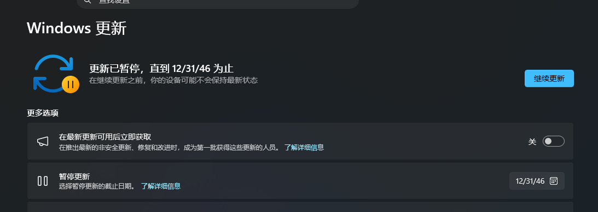

# 如何暂停或延长Win11“下拉式日期选择器、方框点选式日期选择器”系统更新
⚠ 请根据win11 的版本或日期选择器类型来选择适配的方式，否则无效。

## 任何 Win11 版本“不自动检测”方式设置系统更新：

注册表regedit位置：
> HKEY_LOCAL_MACHINE\SOFTWARE\Policies\Microsoft\Windows\WindowsUpdate\AU

右键新建 `NoAutoUpdate` 项 DWORD32 ，十进制值设为 `1` ;

右键新建 `AUOptions` 项 DWORD32 ，十进制值设为 `1` ;

重启系统后生效。

## 仅针对 Win11 26H2/25H2/24H2/23H2 版本“下拉式日期选择器”系统更新：

Win11 26H2系统下载（内核26000，商业版，发布日期：2026-09-29）：
```
magnet:?xt=urn:btih:f7d5530acada1b3c10167e273c05828c1fec1a5b&dn=zh-cn_windows_11_business_editions_version_26h2_x64_dvd_74d48a06.iso&xl=8999364608
```
```
ed2k://|file|zh-cn_windows_11_business_editions_version_26h2_x64_dvd_74d48a06.iso|8999364608|6C2C06933F0F4A238DDEA895DD9CA513|/
```

注册表regedit位置：
> HKEY_LOCAL_MACHINE\SOFTWARE\Microsoft\WindowsUpdate\UX\Settings

右键新建 DWORD32 项 `FlightSettingsMaxPauseDays` ，十进制值设为 `3650` 。之后在设置中暂停更新时下拉框会出现超长选项。

重启系统后生效。

如下图 26H2/25H2 中启用的效果：


## 仅针对 Win11 26H1 版本或类似“方框点选式日期选择器”设置系统更新：

Win11 26H1系统下载（内核28000，商业版，发布日期：2026-10-20）：
```
magnet:?xt=urn:btih:5b318c539b197bd1cca8c7b6f45e399f84d190d5&dn=zh-cn_windows_11_business_editions_version_26h1_updated_oct_2026_x64_dvd_921ccd7c.iso&xl=8711084032
```
```
ed2k://|file|zh-cn_windows_11_business_editions_version_26h1_updated_oct_2026_x64_dvd_921ccd7c.iso|8711084032|A7D6AAE9FB21936E1BAD96FA573C48B4|/
```

注册表regedit位置：
> HKEY_LOCAL_MACHINE\SOFTWARE\Microsoft\WindowsUpdate\UX\Settings

| 键名                                  | 类型         | 值                     |
|---------------------------------------|--------------|------------------------|
| `PauseUpdatesStartTime`               | 项（REG_SZ） | `2026-10-30T00:00:00Z` |
| `PauseUpdatesExpiryTime`              | 项（REG_SZ）       | `2046-12-31T00:00:00Z` |
| `PauseFeatureUpdatesStartTime`        | 项（REG_SZ）       | `2026-10-30T00:00:00Z` |
| `PauseFeatureUpdatesEndTime`          | 项（REG_SZ）       | `2046-12-31T00:00:00Z` |
| `PauseQualityUpdatesStartTime`        | 项（REG_SZ）       | `2026-10-30T00:00:00Z` |
| `PauseQualityUpdatesEndTime`          | 项（REG_SZ）       | `2046-12-31T00:00:00Z` |
| `FlightSettingsMaxPauseDays` （可选） | DWORD (32位) | 选十进制，填 `3560`    |

注意，上面键名要全部填写。

重启系统后生效。

如下图 26H1 中启用的效果：



---

### 原创于 2026-10-30： 

https://github.com/datathankyou/Win11_Update_Stopped 

---